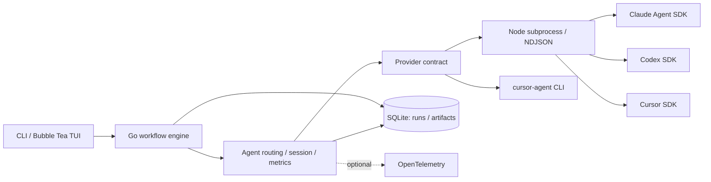

# rilll

[English](README.md) | **日本語**

**AIコーディングエージェントの提案、レビュー、修正、検証をつなぐ、Go製ワークフローオーケストレーター。**

Claude / Codex / Cursor を共通の実行モデルで扱い、ターミナルから複数段階の開発作業を進める。
たとえば README 更新では、提案を作るセッションとレビューするセッションを分け、レビュー結果を元のセッションへ渡して更新する。
仕様から実装へ進むループ、観点別の並列レビュー、実行記録からの学習抽出ができる。

## 主な機能

| 機能 | 概要 | 関連実装 |
| --- | --- | --- |
| 複数AI Providerへの対応 | Goの共通契約と、SDKごとのTypeScript bridgeをNDJSONで接続 | [Provider契約](internal/provider/types.go) / [共有プロトコル](bridge/shared/protocol.ts) |
| ワークフローの合成 | 構造化出力、セッション再開、子ワークフローの結果と成果物の引き継ぎ | [Workflow](internal/workflow/types.go) / [合成処理](internal/workflow/sequential.go) |
| 実装と検証の自動化 | 実装と検証の段階を分け、再試行、修復先、停止条件をコードで制御 | [実装ループ](internal/workflow/builtin/kiro/impl_loop.go) / [反復エンジン](internal/inquiryloop/engine.go) |
| 並列レビューと修正の適用 | YAMLの観点別レビューを並列実行し、修正は提案、判定、適用に分割 | [レビュー実行](internal/workflow/builtin/review/executor.go) / [適用処理](internal/workflow/builtin/review/apply/) |
| 実行履歴と利用量の記録 | SQLiteに実行関係、成果物、利用量を記録し、任意でOpenTelemetryへ送信 | [実行記録](internal/akashic/) / [Telemetry](internal/telemetry/) |
| 実行結果からの学習抽出 | Reflector → Curator → Applyで学習を抽出し、重複整理とファイル反映を分離 | [学習ワークフロー](internal/workflow/builtin/learnings/) |

## 全体構成



Goが工程と状態遷移を管理し、TypeScriptが各SDKへの変換を担当する。
プロンプトの役割や出力形式は [facets](internal/facet/facets/) と [同梱skills](.agents/skills/) に分けて保持している。
[設計解説](docs/architecture.md)では、実装とテストを対応づけて読む順序を示している。

## ローカルで確認する

**Go 1.26.6以上 / Node.js 24.x / npm** が必要。
以下のビルドとテストにAI Providerの認証は不要。

```sh
npm ci --ignore-scripts
npm run build:bridge
go build -trimpath -ldflags "-X github.com/kazuki-oshino/rilll/internal/version.BuildVersion=$(cat VERSION)" -o bin/rilll ./cmd/rilll
./bin/rilll --version
./bin/rilll list

go test ./...
npm run test:bridge
```

`just` がある場合は `just build` と `just test` でも実行できる。
ビルドはバージョンを書き換えず、グローバルのコマンドも上書きしない。
実際のワークフロー実行にはProvider認証が必要で、ファイル編集やコマンド実行を伴う。
実行前に [セットアップと実行権限](docs/setup.md)を確認。

## ドキュメント

- [設計解説とコード案内](docs/architecture.md)
- [セットアップ、設定、実行権限](docs/setup.md)
- [CLI / TUIの使い方](docs/cli.md) / [ワークフロー一覧](docs/workflows.md)
- [実行記録と成果物](docs/akashic.md) / [OpenTelemetry](docs/telemetry.md)
- [Skillsの配置と外部依存](docs/skills.md)

MIT License。詳細は [LICENSE](LICENSE) を参照。
