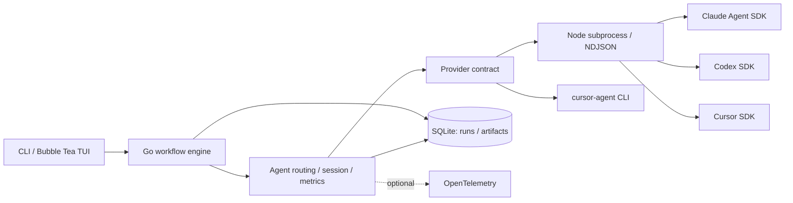

# rilll

**English** | [日本語](README.ja.md)

**A Go workflow orchestrator that connects proposal, review, revision, and verification steps across AI coding agents.**

rilll brings Claude, Codex, and Cursor into a shared execution model for multi-step development workflows in the terminal.
For example, a README update uses separate proposal and review sessions, then passes the feedback back to the original session to make revisions.
It also supports spec-to-implementation loops, parallel reviews, and extracting reusable lessons from execution records.

## Features

| Feature | Description | Implementation |
| --- | --- | --- |
| Multiple AI providers | A shared Go interface connects to provider-specific TypeScript bridges over NDJSON | [Provider interface](internal/provider/types.go) / [Shared protocol](bridge/shared/protocol.ts) |
| Workflow composition | Structured output, session resumption, and passing results and artifacts between child workflows | [Workflow](internal/workflow/types.go) / [Composition](internal/workflow/sequential.go) |
| Implementation and verification | Separate implementation and verification stages, with retries, remediation routing, and stopping conditions controlled in code | [Implementation loop](internal/workflow/builtin/kiro/impl_loop.go) / [Inquiry loop](internal/inquiryloop/engine.go) |
| Parallel reviews and revisions | Run reviews in parallel using YAML-defined rules, then separate revision proposals, evaluation, and application | [Review execution](internal/workflow/builtin/review/executor.go) / [Revision application](internal/workflow/builtin/review/apply/) |
| Execution history and usage tracking | Store run relationships, artifacts, and usage in SQLite, with optional OpenTelemetry export | [Execution records](internal/akashic/) / [Telemetry](internal/telemetry/) |
| Learning from runs | Extract lessons through Reflector → Curator → Apply, separating deduplication from file updates | [Learning workflow](internal/workflow/builtin/learnings/) |

## Architecture



Go manages workflow stages and state transitions, while TypeScript adapts calls to each SDK.
Prompt roles and output formats are organized into [facets](internal/facet/facets/) and [bundled skills](.agents/skills/).
The [architecture guide](docs/architecture.md) provides a reading path through the implementation and its tests.

## Build and test

Requires **Go 1.26.6 or later / Node.js 24.x / npm**.
The build and tests below do not require AI provider authentication.

```sh
npm ci --ignore-scripts
npm run build:bridge
go build -trimpath -ldflags "-X github.com/kazuki-oshino/rilll/internal/version.BuildVersion=$(cat VERSION)" -o bin/rilll ./cmd/rilll
./bin/rilll --version
./bin/rilll list

go test ./...
npm run test:bridge
```

With `just` installed, you can also use `just build` and `just test`.
The build leaves the version and globally installed commands unchanged.
Running workflows requires provider authentication and can involve file edits and command execution.
Read [Setup and execution permissions](docs/setup.md) before running a workflow.

## Documentation

The detailed guides below are currently in Japanese.

- [Architecture and code guide](docs/architecture.md)
- [Setup, configuration, and execution permissions](docs/setup.md)
- [CLI / TUI usage](docs/cli.md) / [Workflow catalog](docs/workflows.md)
- [Execution records and artifacts](docs/akashic.md) / [OpenTelemetry](docs/telemetry.md)
- [Skill locations and external dependencies](docs/skills.md)

MIT License. See [LICENSE](LICENSE) for details.
