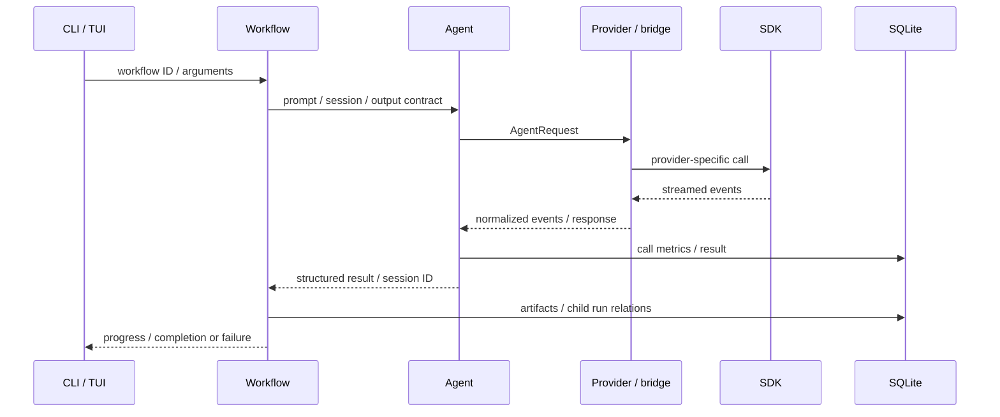

# 設計解説

rilll は、AIエージェントを複数工程の開発ワークフローに組み込むCLIです。
Goが状態遷移と実行結果を管理し、TypeScript bridgeが各Provider SDKを呼び出します。
AIが生成する文章と、プログラムが判定する完了条件を分けることを設計の軸にしています。

## 実行の流れ

CLIとTUIは同じ [Registry](../internal/workflow/builtin/registry.go) を利用します。
UIからProvider SDKを直接呼び出さず、[workflowctx](../internal/workflowctx/types.go) の共通契約を介して実行します。
Workflowの基盤から具体的なbuiltin workflowへの逆依存を避け、合成処理を再利用できる構造にしています。

## Providerの差を境界で扱う

[Provider契約](../internal/provider/types.go)には、要求、応答、ストリーミングイベント、利用量、セッション識別子を定義しています。
SDK系Providerは [共通ランチャ](../internal/provider/nodebridge/launcher.go) がNode子プロセスを起動し、stdio上のNDJSONで通信します。
GoとTypeScriptを分けることで、SDK依存のイベント処理をGoのワークフローから切り離しています。
その代わりに、プロセス終了、キャンセル、標準出力のフレーミング、両言語のスキーマ整合を扱う必要があります。

| 経路 | Adapter | Bridge |
| --- | --- | --- |
| Claude Agent SDK | [claude](../internal/provider/claude/provider.go) | [claude-agent-sdk](../bridge/claude-agent-sdk/src/index.ts) |
| Codex SDK | [codex](../internal/provider/codex/provider.go) | [codex-sdk](../bridge/codex-sdk/src/index.ts) |
| Cursor SDK | [cursorsdk](../internal/provider/cursorsdk/provider.go) | [cursor-sdk](../bridge/cursor-sdk/src/index.ts) |
| cursor-agent CLI | [cursor](../internal/provider/cursor/provider.go) | CLIの出力をGoで処理 |

全Providerが同じ機能を持つとは限りません。
権限、turn上限、構造化出力、モデルの指定は各bridgeで対応し、一部の指定はProviderにより適用されません。
この差は [Goプロトコルのテスト](../internal/bridge/protocol_test.go) と各bridgeの `permission-mode-and-max-turns.test.ts` などで確認できます。

## ワークフローの合成とセッションの分離

[Sequential](../internal/workflow/sequential.go) は、複数のワークフローを順番に実行する共通処理です。
子runの結果と成果物を引き継ぎ、失敗やキャンセルを次の工程へ伝えます。
[合成のテスト](../internal/workflow/sequential_test.go)と [子runのテスト](../internal/workflow/child_runner_test.go) が境界の振る舞いを検証します。

小さな具体例は [README更新](../internal/workflow/builtin/git/readme.go)です。
提案セッションを作り、別セッションでレビューし、元の提案セッションを再開して修正を反映します。
同じコンテキストを全役割で共有することを避けながら、必要な成果物だけを次の工程へ渡しています。

## AIの判断を構造化して制御する

[Inquiry loop](../internal/inquiryloop/engine.go) は、問い合わせと回答を構造化出力で往復させる共通エンジンです。
出力のパース失敗、スキーマ修復の再試行、反復回数の上限、セッションの再開を管理します。
[engine_test.go](../internal/inquiryloop/engine_test.go) では、不正な応答、上限到達、再開チェーン、回答側の新規セッションを検証します。

### 実装後の検証と完了判定

[Kiro実装ループ](../internal/workflow/builtin/kiro/impl_loop.go) は、タスク単位の実装に加え、[最終検証](../internal/workflow/builtin/kiro/impl_loop_final_review.go)を別工程として実行します。
最終検証で修正が入った場合は、テスト実行と結果の抽出を経てからコミットへ進みます。
エージェントの呼び出し失敗、応答形式の不備、テスト失敗の報告はGo側で判定し、その後のコミットを止めます。

ファイル編集と結果の抽出は別ターンに分け、抽出側に渡す許可ツールは読み取りに絞っています。
編集直後に長い構造化出力を求める負荷を減らし、要約のための呼び出しが再編集することを抑える設計です。
[最終検証のテスト](../internal/workflow/builtin/kiro/impl_loop_final_review_test.go)は、失敗時の停止や、修正がない場合の後続工程の省略を検証します。
ただし、テスト結果の収集と報告はエージェントが担うため、報告内容そのものの正しさまで保証するものではありません。

### 検証失敗を修復へ戻す条件

仕様の検証では、指摘の内容に応じて設計工程への再試行と停止を選びます。
[修復先の制御](../internal/workflow/builtin/kiro/spec_loop_remediation.go)は、指摘の分類、識別子、対象ファイル、修正責任の所在を構造化して受け取ります。
自然文の要約は表現が変わるため、同じ問題の反復を数えるキーには、分類や責任範囲とエージェントが返す指摘識別子を使います。
同じ重大な問題の反復と重大指摘の総試行回数に上限を設け、軽微な指摘には記録を残して続行する経路を用意しています。

上流の別仕様を直す必要があると判定した場合は、自動修復を止めて対象と理由を残します。
自動復旧できる範囲を絞ることで、現在の仕様を直すループが別仕様の編集へ広がることを防いでいます。
[分岐のテスト](../internal/workflow/builtin/kiro/spec_loop_remediation_router_test.go)と[責任範囲のテスト](../internal/workflow/builtin/kiro/spec_loop_remediation_ownership_test.go)から、再試行と停止の条件を確認できます。

### 共通エンジンと個別ワークフローの責務

Inquiry loopは、個別ワークフロー向けの追加出力を [Extensions](../internal/inquiryloop/types.go) として受け渡します。
仕様の修復先といった意味の解釈はKiro側に置き、共通エンジンには応答の解析と反復制御を集約しています。
これにより、仕様検証の項目を増やしても、他のワークフローが使う共通の出力形式やProvider間の通信形式へ変更を広げずに済みます。

個別の出力スキーマとプロンプトは、同じフィールドと条件を要求する必要があります。
[契約のテスト](../internal/workflow/builtin/kiro/spec_loop_remediation_contract_test.go)で両者の整合を確認し、判定後の修復先と反復回数は結果ファイルに残して、停止理由を追跡できるようにしています。

## 並列レビューと修正の適用

[レビュー実行器](../internal/workflow/builtin/review/executor.go) は、利用先の `.rilll-config/review-rules/` に置いたYAMLから観点ごとの呼び出しを構成します。
公開版にはプロジェクト固有の規則を同梱せず、[review-rules-skill](../.agents/skills/review-rules-skill/SKILL.md) とテンプレートを保持しています。
[並列性テスト](../internal/workflow/builtin/review/executor_concurrency_test.go)で、実行数の制御や集約を確認できます。

修正は [apply](../internal/workflow/builtin/review/apply/) に分離しています。
事前検査、提案ループ、判定、パッチ反映、キャンセル確認を明示し、Git操作と判定値の不変条件を [invariant_test.go](../internal/workflow/builtin/review/apply/invariant_test.go) で検査します。

## 実行記録から学習まで

[Akashic](../internal/akashic/) はSQLiteに実行結果と利用量を保存します。
ワークフローと子runの関係や成果物のパスも記録し、TUIとCLIから参照できます。
ファイル参照には [サイズ制限](../internal/akashic/artifact_size_guard_test.go) と [パス検査](../internal/akashic/artifact_path_test.go) のテストがあります。
OpenTelemetryは任意で有効化し、実行のtraceとmetricを外部backendへ送ります。

[学習処理](../internal/workflow/builtin/learnings/) は、設定で有効化したワークフローの後段に組み込みます。
Reflectorがrunから候補を抽出し、Curatorが既存知見との整理を行い、Applyがファイルを更新します。
AIの生成結果と書き込み処理を分け、[キャンセル時の保全](../internal/workflow/builtin/learnings/early_safety_e2e_test.go) や [ファイル更新](../internal/workflow/builtin/learnings/wiki_atomic_test.go) を検証します。
実際の開発で蓄積された学習データはこの公開版には含みません。

## プロンプトも検証対象にする

[facets](../internal/facet/facets/) は役割、方針、出力形式を分けたプロンプト断片です。
Kiro系の仕様作成と検証は外部の [cc-sdd](https://github.com/gotalab/cc-sdd) の手順を参照し、rilllが構造化応答と反復制御を追加します。
学習整理やコミットの [独自スキル](../.agents/skills/) は同梱し、スキーマやテンプレートをランタイムと併せて検証します。
スキルの配置とライセンスの境界は [skills.md](skills.md) に記載しています。
Goの制御ロジック、プロンプト、出力スキーマの整合を保つため、[prompt parity](../internal/inquiryloop/prompt_parity_test.go) や [review rule lint](../tools/review-rules-lint/) もテストに含めています。

## 境界と制約

- ローカルの信頼できる作業環境を前提としています。複数利用者を隔離するサービスではありません。
- SDKの権限設定やdeny gateはProviderごとに異なり、完全なセキュリティ境界にはなりません。
- 実行ログや成果物には対象コード、プロンプト、パスが含まれ得ます。公開対象から分離してください。
- テストは制御ロジックと模擬Providerの振る舞いを検証します。モデルの品質や現時点のアカウント利用可否は検証しません。
- ローカルビルドを前提とし、GoバイナリだけではSDK bridgeとNode.jsを置き換えられません。

実行前の設定と権限については [セットアップ](setup.md) を参照してください。
